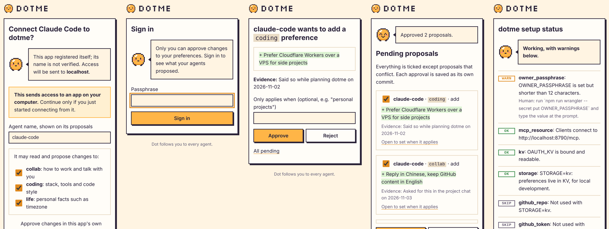
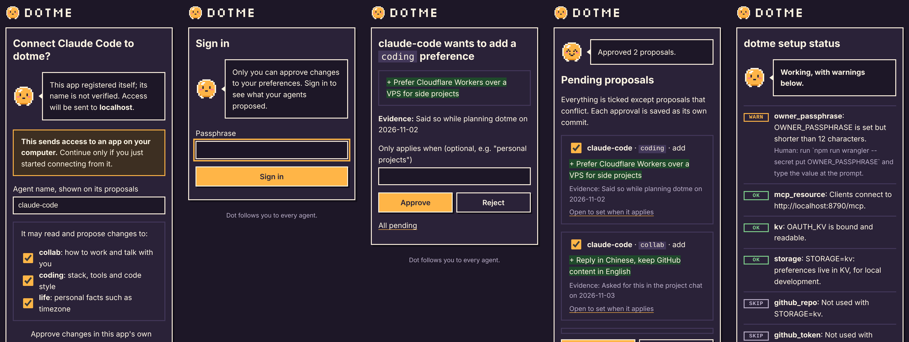

# dotme brand

A small, playful identity for dotme: pixel art with an adventure-game feel,
built around one character.

## Dot

Dot is dotme's mascot and logo: a round pixel companion that follows you to
every agent, the way a partner follows you on a journey. Dot can appear in the
README and the demo video reacting to things, for example celebrating when you
approve a proposal.

Dot is an original character drawn on a 16 x 16 grid. Keep it that way: no
shapes, characters, logos or fonts from existing games.

## Tagline

> Dot follows you to every agent.

Supporting line, for places that need to say what dotme does:

> Self-hosted preferences for your AI agents. You approve every change.

## Assets

All files are in [`assets/brand/`](../assets/brand/).

| File | Use |
| --- | --- |
| `dot.svg` | The mark on light backgrounds. |
| `dot-on-dark.svg` | The mark on dark backgrounds (cream outline). |
| `logo.svg` | Dot plus the wordmark, for light backgrounds. |
| `logo-on-dark.svg` | Dot plus the wordmark, for dark backgrounds. |
| `dot-512.png` | Avatar size, for profile pictures and app icons. |
| `favicon.ico` | 16, 32 and 48 px favicon. |
| `social-preview.svg`, `social-preview.png` | GitHub social preview, 1280 x 640. |

Upload `social-preview.png` in the repository's Settings, under Social preview.

## Palette

| Name | Hex | Use |
| --- | --- | --- |
| Night | `#2A2238` | Outline, text, dark backgrounds |
| Dot | `#FFB547` | Dot's body, the main accent |
| Ember | `#E08A1E` | Dot's shading |
| Blush | `#FF7A8A` | Dot's cheeks; use sparingly |
| Cream | `#FFF4E2` | Outline and text on dark backgrounds |

## Type

- Wordmark: [Silkscreen](https://fonts.google.com/specimen/Silkscreen), outlined
  into the SVGs, so no font is needed to render them.
- Pixel text in images and video (captions, dialog boxes):
  [Pixelify Sans](https://fonts.google.com/specimen/Pixelify+Sans).
- Both are under the SIL Open Font License 1.1.
- Running text in docs stays in GitHub's default font.

The product name is always written in lowercase, `dotme`. The pixel wordmark
renders it in Silkscreen's capitals; that is only the logo's look.

## Usage

- Render pixel art with crisp edges and scale it by whole numbers (16, 32, 64,
  128, 512 px), so pixels stay square. In CSS use `image-rendering: pixelated`.
- Keep at least 2 Dot-pixels of clear space around the mark.
- Use `dot-on-dark.svg` or `logo-on-dark.svg` on any background darker than
  mid-grey; the default outline disappears there.
- Do not recolor, stretch, rotate, or add gradients or shadows to Dot.

## Pixel grid

The mark's source, one character per pixel, for redrawing or animating Dot:

```
................
.....OOOOOO.....
...OOAAAAAAOO...
..OAAWWAAAAAAO..
..OAWWAAAAAAAO..
.OAAAAAAAAAAAAO.
.OAAAEAAAAEAAAO.
.OAAAEAAAAEAAAO.
.OAPPAAAAAAPPAO.
.OAAAAAEEAAAAAO.
.OAAAAAAAAAAAAO.
..OAAAAAAAAAAO..
..OBAAAAAAAABO..
...OOBBBBBBOO...
....OO....OO....
................
```

`O` outline (Night, or Cream on dark), `E` eyes and mouth (always Night),
`A` body (Dot), `B` shading (Ember), `P` cheeks (Blush), `W` highlight (white),
`.` transparent.

## Web pages

Every page the Worker serves (consent, sign-in, approvals, setup status,
errors) shares one layout from `src/html.ts`: the Dot logo and wordmark in the
header, a Cream page with a Night-outlined card, and Dot-colored buttons. Dark
mode swaps to a Night background and Dot's Cream outline.

`src/brand.ts` draws Dot inline from the pixel grid above, so the Worker
serves no image files; the favicon is an inline SVG too. Pages use three
reactions that change only Dot's face: `idle`, `happy` (eyes closed in a
smile, for approvals and a green setup status) and `oops` (a small frown, for
errors). Dot speaks through a dialog box beside it.



